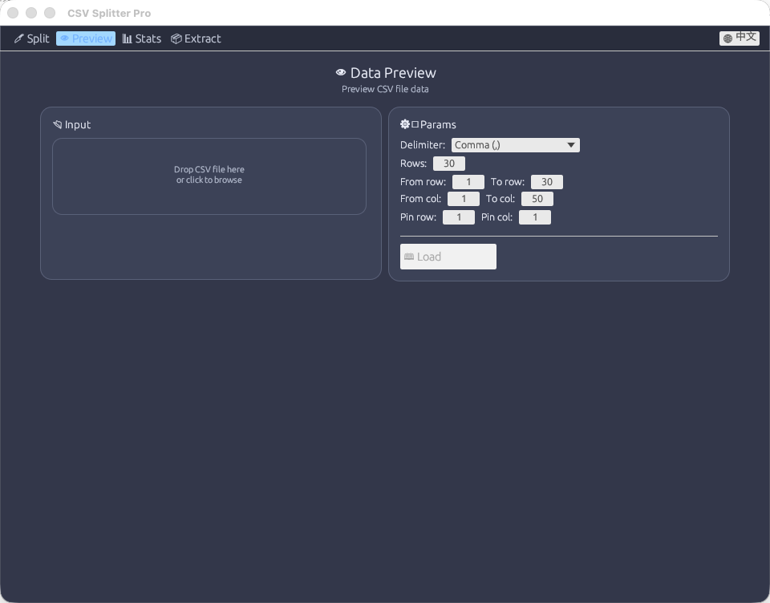
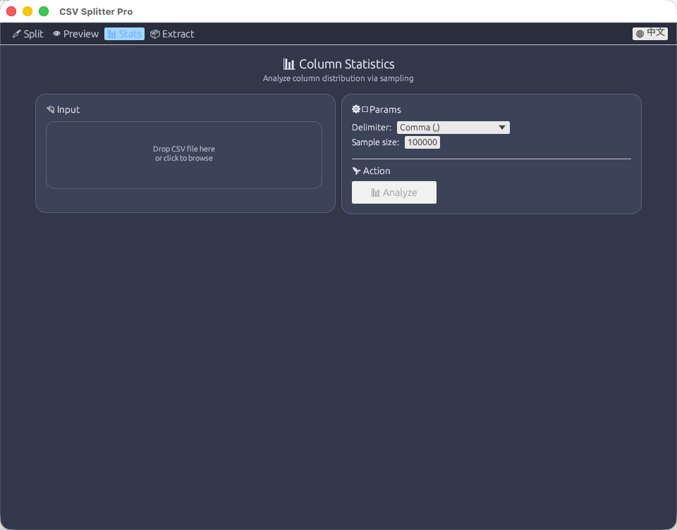
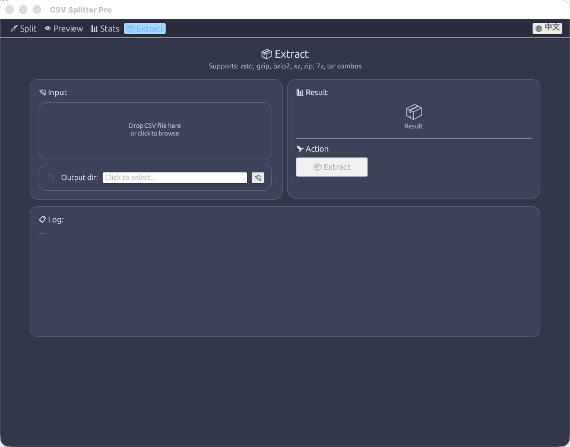

# CSV Splitter Pro

> Cross-platform CSV splitter, compressor, previewer & column statistics tool with bilingual (Chinese/English) UI.
>
> 跨平台 CSV 文件拆分、压缩、预览与列统计工具，支持中英文界面。
>
> **刚上手？** 跑一句 `csv-splitter demo` 生成示例文件，然后看 [10 分钟上手](docs/GETTING_STARTED.md)。

[](https://github.com/Li-Binzhuang/csv-splitter/actions/workflows/ci.yml)
[](https://github.com/Li-Binzhuang/csv-splitter/actions/workflows/release.yml)
[](https://github.com/Li-Binzhuang/csv-splitter/releases/latest)
[](LICENSE)

---

## Quick start / 快速开始

```bash
$ csv-splitter demo            # 生成一份带脏数据的示例文件
$ cd csv-splitter-demo
$ csv-splitter preview orders.csv
$ csv-splitter analyze orders.csv
$ csv-splitter groupby orders.csv --by city --agg "amount:sum,amount:count" --order sum_amount --desc
$ csv-splitter serve --root .  # 本地 JSON API，打开 http://127.0.0.1:8787/ 就能看
```

每一步的真实输出、以及从筛选到交付的完整流程，见 **[10 分钟上手](docs/GETTING_STARTED.md)**。

## Download / 下载

从 [Releases](https://github.com/Li-Binzhuang/csv-splitter/releases/latest) 页面下载对应平台的预编译包：

| Platform | Artifact | Arch |
|----------|----------|------|
| 🐧 Linux | `csv-splitter-linux-x86_64.tar.gz` | x86_64 |
| 🍎 macOS | `csv-splitter-macos-arm64.tar.gz` | Apple Silicon |
| 🍎 macOS | `csv-splitter-macos-x86_64.tar.gz` | Intel |
| 🪟 Windows | `csv-splitter-windows-x86_64.zip` | x86_64 |

> 每个包附带 `.sha256` 校验文件，可用于验证下载完整性。

## Features / 功能

| Feature | Description | 说明 |
|---------|-------------|------|
| 🔪 Split & Compress | Split large CSV into compressed chunks (Zstd/Gzip/Bzip2/XZ/Zip) | 将大型 CSV 拆分为多个压缩分片 |
| 🔄 Toggle Pipeline | Independently enable/disable split and compress steps | 可独立开关拆分与压缩步骤 |
| 📋 Column Filter | Select columns from CSV headers or via filter file | 通过表头选择或过滤文件筛选列 |
| 🔃 Sort | External merge sort by column with numeric-aware ordering | 按指定列外部归并排序，支持数值智能排序 |
| 👁 Data Preview | Preview CSV rows with auto-detected delimiter, row/col range & freeze | 预览 CSV 数据，支持行列范围与冻结 |
| ⚡ Row Index | 8 bytes per 1000 rows sidecar, jump to any row without scanning | 稀疏行索引：跳转到任意行，无需从头扫描 |
| 📊 Column Stats | Reservoir sampling analysis (unique/empty/top frequency) | 蓄水池采样分析列数据分布 |
| 📦 Decompress | Supports Zstd, Gzip, Bzip2, XZ, Zip, 7z, Tar and combos | 支持 12 种压缩格式及其组合 |
| 🌐 i18n | Chinese (default) / English, one-click switch | 默认中文，一键切换英文 |
| 📁 Drag & Drop | Drop files onto cards, shows file metadata | 拖放文件到卡片区域，显示文件元数据 |
| 🎞 Flow Visualization | Animated pipeline: Source → Split → Compress → Result | 动画流程图，动态显示活跃步骤 |
| 🧩 Merge | Re-assemble chunks back into one CSV (inverse of split) | 把分片重新合并回单个 CSV（拆分的逆操作） |
| ✅ Verify | Split → merge round-trip check that proves a split is lossless | 拆分后合并做字节级校验，证明拆分无损 |
| 💻 CLI | Full headless interface for cron / CI / servers, no GUI needed | 完整命令行，适合 cron / CI / 服务器 |
| 🌐 HTTP API | JSON API for a web front-end: browse, search, filter, aggregate, split | 供前端的 JSON 接口：浏览、搜索、筛选、聚合、切分 |
| 🔍 Search | Find text anywhere, or in chosen columns; returns row numbers | 跨列搜索，返回行号（可用 `--start-row` 跳过去） |

## Roadmap / 路线图

当前进度、北极星指标与后续里程碑见 [docs/ROADMAP.md](docs/ROADMAP.md)。

## Screenshots / 截图

### 🔪 拆分压缩 / Split & Compress


### 👁 数据预览 / Data Preview



### 📊 列统计 / Column Statistics



### 📦 解压缩 / Extract



## 卡住了 / When something goes wrong

`docs/TROUBLESHOOTING.md` 按「它说了什么 → 为什么 → 怎么办」组织，覆盖列名打错、
公式报错、编码/引号问题、编辑看不见、上限报错、速度问题。**每段引文都有测试复现。**

## 想改代码 / For contributors

`docs/ARCHITECTURE.md` 有一张**改一处要看哪里**的表：编辑模型的两条身份轴、
三条读路径、不变式分别由什么守住。新增命令或端点时要同步的五处位置，那里都列了，
而且每一处都有测试盯着。

## CLI / 命令行

桌面版适合手动处理，服务器和脚本需要的是无界面入口。`crates/cli` 与 GUI 共用同一套核心管线，
行为不会漂移。

```bash
# 安装到 ~/.cargo/bin
cargo install --path crates/cli

# 拆分（默认 zstd、10 片）
csv-splitter split big.csv -n 8 -f zst -o chunks.tar

# 按目标大小切：每片约 100 MB（片数由数据量决定）
csv-splitter split huge.csv --by-size 100MB -f zip -o huge.zip

# 按列值分区：一个城市一个文件
csv-splitter split orders.csv --by-column city -f zst

# 只要几列，并在拆分前按列排序
csv-splitter split big.csv --columns id,phone,score --sort score --desc -n 4 -f zip

# 合并回单文件（支持 tar / tar.gz / tar.zst / tar.bz2 / tar.xz / zip）
csv-splitter merge chunks.tar -o restored.csv

# 证明这次拆分是无损的：split → merge → 逐字节比较
csv-splitter verify big.csv -n 6

# 建立行索引（1.6M 行 → 13 KB 索引，0.5 秒）
csv-splitter index big.csv

# 跳到任意行（有索引时是微秒级）
csv-splitter preview big.csv --start-row 1500000 --rows 20

# 筛选：返回行号，再用 preview --start-row 跳过去看
csv-splitter filter orders.csv --where "city=CDMX"
csv-splitter filter orders.csv --where "amount>1000" --json

# 看一眼数据与列分布
csv-splitter preview big.csv --rows 5
csv-splitter stats big.csv --sample 50000 --top 5

# 解压任意支持的归档
csv-splitter extract chunks.tar -o ./out
```

所有子命令都支持 `-d/--delim auto|comma|tab|semicolon|pipe|<char>`、`-q/--quiet`、`-h/--help`。


### 命令总览 / Commands

三十条命令，每条一句话。`csv-splitter <command> --help` 给出该命令的全部参数。

| 命令 | 做什么 |
|---|---|
| `split` | 切成若干份（按片数、按大小、按列值），可压缩 |
| `merge` | 把分片合回单文件 |
| `verify` | 证明 split → merge 逐字节无损 |
| `extract` | 解压 tar/zip/7z（成员路径越界会被拒绝） |
| `preview` | 打开看一下，可跳任意行 |
| `view` | 看**套用编辑后**的表：翻页、筛选、排序、查找、条件格式 |
| `index` | 建稀疏行索引 |
| `filter` | 按条件筛选，返回行号或写文件 |
| `search` | 跨列搜索（支持 `--regex`） |
| `stats` | 采样列统计 |
| `analyze` | 全列画像：类型、空值、基数、异常 |
| `validate` | 检查脏数据：非空/数值/日期/唯一/任意比较 |
| `dedupe` | 去重 |
| `columns` | 保留/删除/改名/重排 |
| `concat` | 多个同构 CSV 拼成一个 |
| `partition` | 按列值拆成多个文件 |
| `sort` | 外部排序（恒定内存） |
| `groupby` | 分组聚合 |
| `pivot` | 行×列矩阵（默认直接打印） |
| `chart` | 图表数据 / 终端条形图 |
| `lookup` | 跨表联接（VLOOKUP） |
| `sql` | 对文件跑只读 SQL（DuckDB） |
| `format` | 条件格式：哪些格子该上色 |
| `layout` | 列宽、显示名、冻结、数字格式 |
| `book` | 把一个目录里的 CSV 当成一个工作簿列出来 |
| `files` | 列出可读文件 |
| `edit` | 改数据但不改原文件（set/insert/delete/replace/drop/rename/formula/split-column/undo/redo/export） |
| `convert` | 转码（GBK → UTF-8 等），流式 |
| `demo` | 生成一份带脏数据的示例文件 |
| `serve` | 本地 HTTP API + 内置浏览页面 |

### 设计上的三个保证 / Three guarantees

1. **三种切法**：`-n/--splits` 按片数均分（片差 ≤ 1 条记录）；`--by-size` 按目标大小切
   （片数由 `ceil(数据量 / 目标)` 决定，单片最多超出目标一条记录）；`--by-column` 按某列的
   取值分区，一个值一个文件（空值落 `_empty`，文件名自动清洗，值过多会报警而不是生成上千个文件）。
2. **无损**：`split` 按*逻辑记录*切分（引号内换行的字段算一条记录），`merge` 去掉重复表头后按序拼接，
   `verify` 用字节比较兜底。`splits > 记录数` 时不会产生空分片。
3. **内存可控**：`--buf-mb` 是**总预算**，拆成 N 片不会变成 N × 缓冲。旧版每片固定 64 MB，
   10 片时峰值接近 700 MB。

## 基础能力 / Basics

一个 CSV 工具首先得能「打开、看见、找到、拿出去」。对应的最小命令集：

| 想做的事 | 命令行 | HTTP |
|---|---|---|
| 看看有什么文件 | `files --root ~/data` | `GET /files?ext=csv` |
| 打开看一眼 | `preview big.csv --rows 20` | `GET /meta` + `GET /rows` |
| 跳到某一行 | `preview big.csv --start-row 1500000` | `GET /rows?start=N` |
| 找某个值（跨所有列） | `search big.csv refund` | `GET /search?q=refund` |
| 按列筛选 | `filter big.csv --where "city=CDMX"` | `GET /filter?where=city=CDMX` |
| **筛完直接存文件** | `filter ... -o out.csv` | `GET /export?where=...` |
| **整表排序** | `sort big.csv --by amount -o sorted.csv` | `POST /sort` |
| 统计列分布 | `stats big.csv --sample 50000` | `GET /stats?sample=50000` |
| **摸清一份陌生数据** | `analyze big.csv` | `GET /analyze` |
| **去重** | `dedupe big.csv --by id -o clean.csv` | `POST /dedupe` |
| **整理列再发出去** | `columns big.csv --drop id --rename "city:城市"` | — |
| **筛选后按多列排序** | `filter big.csv --where "amount>100" --order "city,amount:desc" -o out.csv` | `GET /rows?where=&order=` |
| **多列排序** | `sort big.csv --by "city,amount:desc"` | `POST /sort` |
| **改数据（不重写原文件）** | `edit set …` / `edit insert …` / `edit export -o fixed.csv` | `POST /edit` |
| **按某列拆成多个文件** | `partition big.csv --by city` | `POST /partition` |
| **多个同构文件拼成一张表** | `concat a.csv b.csv c.csv -o all.csv` | — |
| **分组汇总** | `groupby big.csv --by city --agg "amount:sum"` | `GET /groupby` |
| 跑聚合 / 排序 | `sql big.csv "SELECT ..."` | `GET /query?sql=...` |
| 切分 / 合并 | `split` / `merge` | `POST /split` · `POST /merge` |
| 换编码 | `convert gbk.csv -o utf8.csv` | — |
| 把文件给出去 | — | `GET /download?path=`（原始字节） |
| 把查询结果拿出去 | — | `GET /export?sql=...`（CSV 文本） |
| 无损自检（字节级） | `verify big.csv -n 6` | — |
| **写操作自检（计数级）** | 写操作自检（计数级） | `filter … --verify` / `sort … --verify` / `partition … --verify` | — |

```bash
$ csv-splitter search orders.csv refund --show 3
scanned 200000 rows, matched 2 (2 shown)
rows (1-based, header excluded): 1, 3

        1  1 | CDMX | refund issued
        3  3 | CDMX | pay refund later
```

### 认识一份数据

```bash
$ csv-splitter analyze orders.csv
column                    rows    empty  distinct  summary
id                      200000        0  ≥100000  min 0.00  max 199999.00  mean 99999.50  median 99760.00  sum 19999900000.00
city                    200000        0         5  text: Tijuana (40189), CDMX (40116), Guadalajara (39987)
note                    200000    40171         4  text: ok (40370), 多行备注 (40034), quote"inside (39797)
```

一个流式 pass 出全部结论：空值数、去重数、数值列的 min/max/均值/中位数/求和、
文本列的长度极值与高频值。**数值列必须有全部非空值都是数字**才算数值列——
一个 `N/A` 就会让它退回文本列并标注 `mixed`。去重数超过上限会显示 `≥N`，
而不是假装自己精确。

```bash
$ csv-splitter dedupe orders.csv --by cust_no -o clean.csv
✓ 49124 of 200000 rows kept, 150876 removed → clean.csv (3.0 MB)
```

### 分组汇总

```bash
$ csv-splitter groupby orders.csv --by city --agg "amount:sum,amount:mean,amount:count" --order sum_amount --desc
✓ 200000 rows → 5 groups → orders.grouped.csv (268 B)

city,sum_amount,mean_amount,count_amount
Tijuana,1812328212.7,45095.13,40189
Puebla,1803568070.11,45219.21,39885
```

聚合算子：`count` / `sum` / `mean` / `min` / `max`，可多列、可多 key。
内存只跟**分组数**有关，不跟行数有关；超过 `--max-groups`（默认 100 万）会
报错而不是把内存吃满——按 id 分组基本总是误操作。

求和用了补偿求和（Kahan），否则 4 万行累加后在末位会看出偏差。

文本列的 `sum`/`mean` 输出 `<mixed>` 而不是悄悄只算数字行；`min`/`max` 在
文本列上按字典序。

### 拆分与拼接

```bash
# 每个 city 一个文件，打包成 tar（不按大小切，按值切）
$ csv-splitter partition orders.csv --by city -o per_city.tar
✓ partitioned by city → per_city.tar (12.1 MB)

# 多个月的导出拼成一张表；表头会自动核对
$ csv-splitter concat march.csv april.csv may.csv -o q2.csv
✓ 3 files, 2100000 rows → q2.csv (280 MB)
```

`partition` 内部先按该列做外部排序（等值聚到一起，一次只开一个写句柄），
所以高基数列不会撞上文件句柄上限；超过 `--max-partitions`（默认 512）会拒绝，
因为按 `id` 分区基本总是误操作。

`concat` **默认核对表头**：列名不一致直接报错并指出是哪个文件。想强行拼接加
`--ignore-header`——它会拼，但会把不一致的文件列出来。

### 整理列

```bash
$ csv-splitter columns orders.csv --drop internal_id --rename "city:城市,amount:金额" -o share.csv
✓ 200000 rows × 5 columns → share.csv (9.8 MB)
    columns: id, cust_no, 城市, 金额, ts
    dropped: note
```

`--keep a,b` 只保留并重排，`--drop a,b` 删掉，`--rename old:new` 改名。
既要保留又要删同一列会**直接报错**，而不是让某一方悄悄赢。

和 `filter --out` 不同，这里**必须重新序列化**（列集合变了）：含逗号、引号、
换行的单元格会按 CSV 规则重新加引号，多行字段进去是一条记录、出来也是一条。

按整行去重（默认）或按 `--by` 指定的列去重，保留**首次出现**的那条。
内存只存 128 位哈希（每条 16 字节），1000 万条约 160 MB；超过 `--max-keys`
会**报错而不是悄悄丢行**。

### 筛选与排序

```bash
# 两个条件 = AND；重复 --where 即可
csv-splitter filter orders.csv --where "city=CDMX" --where "amount>45000" -o cdmx.csv
# ✓ 19836 of 200000 rows matched → cdmx.csv (1195614 bytes)

# --any 改成 OR
csv-splitter filter orders.csv --where "city=Tijuana" --where "amount>49990" --any -o any.csv

# 多列排序，逐列指定方向
csv-splitter sort orders.csv --by "city:asc,amount:desc" -o sorted.csv
# 单列仍是最简单的写法
csv-splitter sort orders.csv --by amount --desc -o sorted.csv

# 枚举几个值
csv-splitter filter orders.csv --where "city in CDMX,Puebla,Tijuana" -o in.csv

# 正则筛选（col~re: 前缀），可与其他条件用 AND / OR 组合
csv-splitter filter orders.csv --where "note~re:^REFUND" --where "amount>1000" -o hits.csv
```

`-o` 是「筛完留下来」的路径：流式写出，命中行的**原始字节原样保留**（不重新序列化，
引号风格和换行都不变）。不带 `-o` 时仍然只列出行号，方便跳转查看。

对方便前端的那一侧：`GET /export?where=city%3DCDMX|amount%3E100` 直接返回筛选后的 CSV；
`POST /sort?by=amount&desc=1&out=sorted.csv` 起一个后台排序任务。

搜索默认**不区分大小写、跨所有列做子串匹配**；`--columns city` 收窄范围，
`--case` 区分大小写，`--exact` 要求整格相等（`--case`/`--exact` 可以和 `--columns` 组合）。

## 编码 / Encoding

自动识别 **UTF-8 / UTF-8 BOM / GBK / UTF-16 LE / UTF-16 BE**：

- 预览、列统计、切分（含列过滤）、API 都按识别结果解码，中文不再乱码
- UTF-8 BOM 会被剥离，不会污染第一个列名
- 行索引基于字节偏移，适用于 **UTF-8 与 GBK**（两者的 `,` 和换行都是 ASCII，不会出现在多字节字符里）；
  UTF-16 的换行是两字节，随机访问会明确报错而不是给出错位数据
- 需要随机访问 UTF-16 文件时先转码，之后就是一个普通 UTF-8 CSV：

```bash
csv-splitter convert export.csv -o export.utf8.csv     # 自动识别来源编码
csv-splitter index export.utf8.csv
```

### 错误形状 / Error shape

客户端错误统一返回 400 + 机器可读字段：

```json
{"error":"by is required","parameter":"by","hint":"pass by=<column name>"}
```

`parameter` 让前端能定位到具体输入框，`hint` 告诉调用方该传什么。
服务端/文件问题返回 422，错误信息来自引擎原文。

### 内置页面 / Built-in viewer

`serve` 起来后直接打开 `http://127.0.0.1:8787/`，有一个单文件 HTML 页面：

- 文件列表（来自 `/files`，只列根目录内的文件）
- 行浏览：翻页、跳行、按条件筛选、跨列搜索
- 列画像：一键跑 `/analyze`，ragged 行会红字提示
- 分组汇总：填分组列和聚合表达式

它只用公开端点（`/files` `/meta` `/rows` `/search` `/analyze` `/groupby`），
**不做任何私有通道**——所以它能做到的，任何真正的前端都能做到；它也能当成
「后端做完了」的可视化证明，以及前端接手的参考实现。

### 查询结果缓存 / Result cache

滚动不该每次都重扫文件。`/rows?sql=` 第一次执行会把结果物化（默认上限 20 万行、
总预算 40 万行），之后翻页直接切片：

```bash
# 第一页：真正跑查询
time curl ".../rows?path=big1g.csv&sql=SELECT city,amount FROM t ORDER BY amount DESC&start=0&count=20"
# 0.70s   {"start":0,"hasMore":true,"rowsSoFar":200000,...}

# 第二页：命中缓存
time curl "...&start=20&count=20"
# 0.00s   {"start":20,"hasMore":true,"rowsSoFar":200000,...}
```

**预热**：含引号换行的文件会回退到串行扫描，10 GB 上首次查询要几秒。
客户端一确定筛选条件就先 `POST /warm`，用户开始滚动时缓存已经就绪：

```bash
curl -X POST "http://127.0.0.1:8787/warm?path=big1g.csv&sql=SELECT city,amount FROM t ORDER BY amount DESC"
# {"job":"job1a1c094da0d0"}     然后轮询 /job?id=...

# 预热完成后再取第一页
# 0.03s  {"start":0,"hasMore":true,"rowsSoFar":200000,...}
```

已缓存时 `/warm` 返回 `200 {"cached":true}` 而不是再起一个任务；非法 SQL 在起任务前就 400。

语义上诚实的三点：

- 结果超过上限时只物化前缀，`rowsSoFar` 告诉你缓存里有多少行；
  请求落在前缀内照常切片，**越过前缀则返回 422 让你收窄查询**，而不是假装结果就这么多
- 文件长度或 mtime 变了就失效
- 预算超了按 LRU 淘汰；超限的结果不进缓存（避免把「不完整」当「完整」）

### 长任务 / Long-running jobs

拆分、合并这类动辄几分钟的操作不占连接：POST 提交，立刻拿到 job id，之后轮询。

```bash
# 提交
curl -X POST "http://127.0.0.1:8787/split?path=big.csv&splits=8&format=zst&out=parts.tar"
# => {"job":"job1a2b3c4d"}

# 轮询（fraction 0..1，elapsed 秒，messages 是最近 20 条阶段信息）
curl "http://127.0.0.1:8787/job?id=job1a2b3c4d"
# => {"state":"running","phase":"Splitting & compressing","progress":52428800,"total":134217728,"fraction":0.391,...}

curl "http://127.0.0.1:8787/jobs"     # 最近 50 个任务
```

- 输出路径同样受 `--root` 约束：`out=../../tmp/x.tar` 返回 400
- 任务跑在自己线程上，客户端断开不影响它
- 完成的任务保留最近 50 个，运行中的不会被回收

## SQL / 分析

手写 GROUP BY、窗口函数、类型推断是这类工具最终烂掉的原因。这里把 **DuckDB** 接进来——
它原生读 CSV、并行扫描、有真正的优化器，我们只做门口的一道检查。

```bash
csv-splitter sql orders.csv "SELECT city, count(*) n, round(avg(amount),1) q FROM t GROUP BY 1 ORDER BY n DESC"
csv-splitter sql orders.csv "SELECT * FROM t" --limit 5 --json
```

```bash
curl "http://127.0.0.1:8787/query?path=orders.csv&sql=SELECT%20city,count(*)%20FROM%20t%20GROUP%20BY%201"
```

**规则**（因为这是暴露给 HTTP 的）：

- 只允许单条 `SELECT` / `WITH`
- 拒绝 `INSERT/UPDATE/DELETE/DROP/CREATE/ALTER/ATTACH/COPY/EXPORT/INSTALL/PRAGMA...`
- 拒绝 `read_csv_auto()` 之类的文件读取函数——数据只能来自 `--root` 白名单内那个文件
- 结果默认上限 1000 行（`--limit` 可调，最高 10 万），`truncated` 字段告知是否被截断
- 文件以视图 `t` 注册，查询里不需要写路径

**实测**（20 万行 CSV，4 个城市分组求和）：

```
city | n | avg_amt
Tijuana | 50127 | 44916.4
CDMX    | 50069 | 45221.4
...
4 row(s) in 0.67s
```

> DuckDB 已随二进制静态编译（`bundled`），无需安装。它是可选 feature `sql`，不使用时可以关掉。

## HTTP API / 后端接口

前后端分离时的后端：一个只读 JSON API，浏览器只请求「当前屏幕上的那几十行」，
文件再大也不进内存。

```bash
csv-splitter serve --root ~/data --addr 127.0.0.1:8787
```

| 端点 | 说明 |
|------|------|
| `GET /health` | 存活检查 |
| `GET /meta?path=REL` | 行数、字节数、表头、分隔符、编码 |
| `GET /rows?path=REL&start=N&count=M` | 任意行窗口（count ≤ 2000） |
| `GET /rows?path=REL&sql=...&start=N&count=M` | **查询结果的第 K 页**（结果物化一次后走缓存，翻页 0 ms） |
| `GET /stats?path=REL&sample=N` | 列统计（唯一值 / 空值 / Top N） |
| `GET /filter?path=REL&where=col=value` | 全表筛选，返回命中的行号（1 起，不含表头） |
| `GET /query?path=REL&sql=SELECT...` | 对文件跑只读 SQL（DuckDB） |
| `POST /split?path=REL&splits=N&format=zst&out=REL` | 提交拆分任务，返回 job id |
| `POST /merge?path=REL&out=REL` | 提交合并任务，返回 job id |
| `GET /download?path=REL` | 原始字节（`Content-Disposition: attachment`） |
| `GET /export?path=REL&sql=...` | 查询结果作为 CSV 文本，可直接喂给别的工具 |
| `POST /warm?path=REL&sql=...` | 后台预热查询结果缓存（返回 job id） |
| `GET /job?id=...` / `GET /jobs` | 任务状态 / 近期任务列表 |

约束与安全：

- 只绑定回环地址（传入非回环地址会打印警告）
- 所有 `path` 都相对 `--root` 解析，`canonicalize` 后必须仍在根目录内，`../` 直接 400
- 已带 `Access-Control-Allow-Origin: *`，任意前端可直接跨域调用
- 无写操作；split/merge 的任务化 API 在路线图 M3

示例：

```bash
curl "http://127.0.0.1:8787/meta?path=huge.csv"
curl "http://127.0.0.1:8787/rows?path=huge.csv&start=18000000&count=20"
```

## HTTP API

20+ 端点的完整说明（参数、响应形状、错误约定、可直接复制的 curl）：
[docs/API.md](docs/API.md)。

## 能力全貌 / Capabilities

一页看完能做什么、边界在哪：[docs/CAPABILITIES.md](docs/CAPABILITIES.md)。

## 清理 / Cleanup

压测会留下大文件，构建会留下 `target/`：

```bash
scripts/clean.sh          # 清压测残留
scripts/clean.sh --all    # 连构建产物一起清
```

## 透视表 / Pivot

```bash
$ csv-splitter pivot sales.csv --rows city --cols month --values "amount:sum"
city,2024-01,2024-02,...
CDMX,8300408,8300337,...
Puebla,...
```

行维度 × 列维度 × 多个度量，一次扫描。`--qualify` 会把度量名写进表头
（`Feb · sum_amount`），多个度量并存时必需。

| 参数 | 说明 |
|---|---|
| `--rows` | 变成行的列，可多个（`,` 分隔） |
| `--cols` | 变成列头的列；省略就退化成 `groupby` |
| `--values` | `列:op`，可多个；op 为 `count/sum/mean/min/max` |
| `--qualify` | 表头带度量名 |
| `--max-columns` / `--max-cells` | 矩阵尺寸上限（默认 512 / 200 万） |

**内存只在矩阵上**：5 个城市 × 12 个月 × 1 个度量 = 60 个累加器，跟输入是
1000 行还是 1 亿行无关。代价是矩阵可能爆炸（比如按 id 透视），所以有两道硬上限，
**在占内存之前**就报错并说明该调哪个参数。

实测：**100 万行 → 5×12 矩阵，1.56 秒**（debug 构建）。

## 条件格式 / Conditional formatting

规则由**服务端求值**，返回的是「哪些单元格该上色」——不是整表的重绘数据。
一屏 100 行就只读 100 行，文件多大都一样。

```bash
$ csv-splitter format orders.csv --rule "amount>1000:bg=red" --rule "status=late:fg=orange"
2 cell(s) match in rows 0..100
  row      1  amount       = 1200                 → {"background":"#f44336"}
  row      2  status       = late                 → {"foreground":"#ff9800"}
```

规则写法（一行一条，能直接放进 URL 或 shell 参数）：

```
<列><运算符><值>:<样式>
  amount>1000:bg=red
  city~CDMX:bg=#ffd54f,bold
  amount between 10,2000:fg=white
  status empty:italic
  id matches ^2024\d{4}$:bg=green
```

| 运算符 | 含义 |
|---|---|
| `>` `>=` `<` `<=` `=` `!=` | 数值比较（非数字一律不匹配） |
| `~` / `^` / `$` | 包含 / 开头是 / 结尾是 |
| `matches` | 正则（支持 `\d` `\w` `[a-z]` `{n}` `{n,m}` `.` `*` `+` `?` `^` `$`） |
| `between lo,hi` | 闭区间 |
| `empty` / `nonempty` | 空 / 非空 |

样式：`bg=` / `fg=` 加颜色（`red` `green` `yellow` `orange` `blue` `grey` `white` `black` 或 `#rgb`/`#rrggbb`），加 `bold` / `italic`。

两条规则命中同一格时**后面的赢**——这样可以先写通用规则、再写精修规则，不用让每条规则互斥。

`--summary` 扫全表只统计命中数，用来在有人看到颜色之前发现「这条规则太宽了」：

```bash
$ csv-splitter format orders.csv --rule "amount>50:bg=yellow" --summary
3 rows scanned
     2 rows (66.7%)  amount>50:bg=yellow
```

API：`GET /style?path=&rules=rule1;rule2&start=&count=`。

## 图表数据 / Chart data

不改行、不搬数据——服务端只给「类别 + 每个系列的数值」，怎么画是前端的事。

```bash
$ csv-splitter chart sales.csv --x month --y "amount:sum" --series city --type bar
{"type":"bar","rows":5,"categories":["Jan","Feb"],
 "series":[{"name":"CDMX","points":[15,20]},{"name":"Puebla","points":[30,40]}]}
```

| 参数 | 说明 |
|---|---|
| `--x` | 类别轴（横轴）列 |
| `--y` | 度量 `列:op`（count/sum/mean/min/max） |
| `--series` | 分组列，每个值一条线/一根柱 |
| `--type` | `line` / `bar` / `pie` / `area` |
| `--sort-by-value` | 按总量排序（饼图几乎总要） |
| `--max-points` | 类别上限（默认 5000） |

**缺失的点是 `null`，不是 0** —— 折线图会画出断口，而不是掉到零。
这条如果错了，图上会出现一段"业务归零"的假象。

**成本跟类别数走**：100 万行按月 = 12 个点，一遍流式扫描。

API：`GET /chart?path=&x=&y=&series=&type=`。

## 显示元数据 / Column metadata

列宽、表头显示名、冻结列、数字格式——这些**不改单元格的值**，所以放在单独的
`<file>.view` 里，不跟编辑日志混在一起：

| 文件 | 变的是 | 丢弃的代价 |
|---|---|---|
| `.journal` | 单元格**是什么** | 数据没了 |
| `.view` | 单元格**长什么样** | 重新调一下就行 |

合并它们会让「重置列宽」变成一次需要撤销的编辑操作。

```bash
$ csv-splitter layout orders.csv --set "amount:format=#,##0.00" --set "city:width=160"
$ csv-splitter layout orders.csv
orders.csv
  城市               width 160px  format plain
  amount           width -      format #,##0.00
```

| 属性 | 写法 |
|---|---|
| `name` | `city:name=城市` |
| `width` | `city:width=160`（24–2000） |
| `frozen` | `id:frozen=true`，或 `--freeze-first N` 一次冻结前三列 |
| `format` | `#,##0.00` / `0.00` / `0%` / `0.0%` / `$#,##0.00` |

数字格式只对**数字**生效：`N/A` 原样显示——格式是对数字的承诺，对文本瞎改更糟。

API：`GET /layout?path=`，`GET /layout?path=&column=&key=&value=`（设置），
`/sheet` 的响应里带 `layout`，前端一次请求拿到数据和列宽。

### 冻结列

冻结是**前缀**语义：冻结第 1、2 列有意义，只冻结第 3 列没意义（前两列会滚走）。
所以服务端不返回「哪些列被勾了」，而是返回**从左边数起连续冻结了几列**：

```json
{"columns":["id","city","amount"],"frozenColumns":["id","city"],"rows":[...]}
```

前端据此把表格切成两栏：`frozenColumns` 那一栏不参与横向滚动，其余跟着滚。
服务端不重复发数据——行里本来就有全部列值。

## 编辑与只读命令的关系

只读命令（`filter` / `sort` / `search` / `sql` / `analyze` / `stats` / `groupby` /
`pivot` / `chart` / `preview`）读的是**原始字节**，不会套用日志里的编辑——这是
「原始文件不可变」的直接后果。它们会明说：

```
$ csv-splitter filter orders.csv --where "city=CDMX"
note: 1 pending edit(s) in orders.csv.journal are not applied by this command;
      run `csv-splitter edit export orders.csv` to materialise them
```

要走编辑后的数据，先 `edit export`，再对导出的文件操作。

**HTTP API 不一样**：`/rows` 的 `where` / `order` 会先物化编辑后的表再查，
因为前端不该看到两套数。物化走临时文件（**每份源文件最多一个**，日志变了就替换旧的），
并且有 **2 GB 上限**——超了直接报错让你先 `edit export`，而不是悄悄把磁盘写满。

## 跨表查找 / Lookup (VLOOKUP)

```bash
$ csv-splitter lookup orders.csv --key cust_no --from customers.csv --get name,city
✓ 2 of 3 rows matched (1 missing) → orders.lookup.csv (84 B)

order,cust_no,amount,name,city
A,1,100,Ana,CDMX
B,2,50,Beto,Puebla
C,9,10,#N/A,#N/A
```

**不对称是有意的**：参照表（客户、商品、编码）读进内存，主表流式扫描。参照表天然小，
要补的那张表才可能是上亿行。

| 行为 | 说明 |
|---|---|
| 未匹配 | 写 `#N/A`，**不是空单元格** —— 空值会被当成真实数据 |
| 重复键 | 取**第一条**（跟 VLOOKUP 一致） |
| 列名冲突 | 加 `_ref` 后缀，不会出现两个同名列 |
| 参照表过大 | 超过 `--max-keys`（默认 500 万）报错并说明调哪个参数 |
| 编码 | 主表和参照表各自探测，结果写 UTF-8 |

参照表的键默认与主表同名列；不同名时用 `--from-key`。

## 错误信息 / Error output

只有两种形状，脚本可以直接按前缀判断：

| 类型 | 退出码 | 形态 |
|---|---|---|
| 用法错误 | **2** | `error: <原因>`（stderr） |
| 运行时失败 | **1** | `✗ <命令>: <原因>`，下面可能有一行 `hint:` |

```
$ csv-splitter preview /definitely/not/here.csv
✗ preview: No such file or directory (os error 2)
  hint: check the path; `csv-splitter files --root DIR` lists what is readable

$ csv-splitter filter orders.csv
error: filter needs at least one --where <expr>
```

`hint` 只在**有明确下一步**时出现（编码不支持 → 告诉你用 `convert`；
列名找不到 → 告诉你用 `analyze` 看真实列名；分组太多 → 建议换列或调上限）。
不该有的提示语不如没有。

## 编辑 / Editing

表格工具的核心是**改**，不是只看。但把 10 GB 读进内存来改是做不到的，所以这里反过来：

```
不可变的基础文件  +  追加式操作日志  =  一份「可编辑的表」
```

每次编辑都往旁边的 `<文件>.journal` 追加一条操作，**基础文件永远不动**。读窗口时把逻辑行映射到物理行再套用改动；导出才物化一次。

```bash
$ csv-splitter edit set orders.csv --row 1 --col city --value Monterrey
✓ set row 1 'city' = 'Monterrey' (1 operation(s) pending)

$ csv-splitter edit status orders.csv
orders.csv
  journal: orders.csv.journal (1 operations)
    1. set row 1 'city' = 'Monterrey'

$ csv-splitter edit export orders.csv -o fixed.csv
✓ 4 rows × 3 columns → fixed.csv (63 B)
```

| 操作 | CLI | API |
|---|---|---|
| 改单元格 | `edit set --row N --col C --value V` | `POST /edit?action=set&row=&col=&value=` |
| **条件批量改** | `edit set --where "city=CDMX" --col C --value V` | `action=set&where=city%3DCDMX&col=&value=` |
| 插入行 | `edit insert --row N --value "a,b,c"` | `action=insert` |
| 删除行 | `edit delete --row N --count K` | `action=delete` |
| 查找替换 | `edit replace --from X --to Y [--col C]` | `action=replace` |
| 删列 / 改名 | `edit drop --name C` / `edit rename --from A --to B` | `action=drop` / `rename` |
| **插入列（常量）** | `edit insert-column --name N --value V [--after C]` | `action=insert-column&name=&value=&after=` |
| **插入列（公式）** | `edit insert-column --name N --formula E [--after C]` | `action=insert-column&name=&formula=&after=` |
| **区域复制** | `edit copy --from "A2:C5" --to "B10"` | `action=copy&from=&to=` |
| 撤销 | `edit undo` | `action=undo` |
| 查看日志 | `edit status` | `GET /edit` |
| 物化输出 | `edit export [-o F]` | `POST /edit?action=export&out=` |

### 公式列 / Computed columns

```bash
$ csv-splitter edit formula orders.csv --name total --value "round(amount * qty, 2)"
✓ add column 'total' = round(amount * qty, 2) (1 operation(s) pending)

$ csv-splitter edit export orders.csv -o out.csv
id,city,amount,qty,total
1,CDMX,10,3,30
```

公式**不落盘**：导出或读窗口时逐行现算，所以给一亿行加一列计算列，也不多占一个字节。

支持的语法（刻意保持小，够用且可预测）：

| 类别 | 写法 |
|---|---|
| 算术 | `+ - * / %`，括号，负号 |
| 比较 | `= <> > >= < <=`（两边都是数字就数值比较，否则按文本） |
| 逻辑 | `if(条件, 真值[, 假值])` `and()` `or()` `not()` `isblank()` `isnumber()` `iferror(v, 兜底)` |
| 文本 | `&` 拼接、`left` `right` `mid` `len` `upper` `lower` `trim` `replace` `concat` |
| 数字 | `round(x[,位数])` `abs` `floor` `ceil` `int` `sqrt` `mod` `min` `max` |
| 日期 | `year(d)` `month(d)` `day(d)` —— 取 ISO 前缀（`2024-03-15` 和带时间的都行） |
| A1 引用 | `B2 * C2` —— 按列位置引用，在整列公式里就是「本行」 |
| 上一行 / 累计 | `lag(amount)` · `lag(amount, 3)` · `running_total(amount)` —— 内存只与「往前看几行」有关 |
| 行号 | `row()` —— 第 1 行是 1，用来做序号 / 奇偶交替 / 交替配色 |
| 列引用 | `amount`，带空格或中文用 `[客户编号]` |
| 跨表引用 | `ref("customers.csv", "cust_no", "name")` —— 本行的 cust_no 去那张表查 name |
| 字符串 | 双引号或单引号：`"缺货"` |

跨表引用只加载**被引用的那张表**（天然小），主表仍然流式；查不到的键得 `#N/A`。
表名相对主表所在目录解析，文件移动后公式照常工作。被引用的表不存在时，
**导出前就报错**，而不是写出一列 `#N/A`。

`if` **只算选中的那个分支**——`if(qty=0, 0, amount/qty)` 不会因为另一个分支除零而报错。

语义跟电子表格对齐：**空单元格当 0**，**非数字文本得 `#VALUE!`**，
**除零得 `#VALUE!`**，**引用不存在的列 = 导出前直接报错**（而不是给一亿行写满 `#VALUE!`）。

### 为什么是日志，而不是覆盖写

- **撤销是免费的**：弹掉最后一条。
- **批量编辑记成一条规则**：改一百万行匹配的数据，日志仍然只有一行（28 字节）。
- **复制的区块存的是值**，不是「指向来源」——否则改来源会改写历史。上限 10 万格。
- **日志是 CSV**，能在编辑器里打开、能 diff、能跟着数据一起提交。
- **体积跟操作数走，不跟行数走**：100 万行文件 + 3 次编辑 = **60 字节**。
- **原文件还在**：改错了直接撤销，或者干脆不导出。

### 编辑是「粘在行上」的，不是「粘在位置上」

先改第 50 万行，再在第 7 行插一行 —— 那条改动会**跟着它原来那一行往下走**，而不是错位到新的第 50 万行。做法是把 `set` 解析成稳定的行身份（基础文件的物理行号 / 插入块编号），插入和删除只改变它们在逻辑空间的位置。

这条如果做错，表现是「改完导出，数据出现在隔壁那一行」—— 而且往往要过几天才发现。

## 自检 / Self-checks

每个写操作都会对结果做一个承诺，`--verify` 让它**去验证自己的承诺**：

| 操作 | 承诺 | 怎么验 |
|---|---|---|
| `split` / `merge` | 字节一致 | `verify`（逐字节比较） |
| `filter -o` | 输出里正好是命中的那些行 | 重读输出，比对行数、列数、继承的 ragged 行数 |
| `columns` | 行数不变，正好是留下的那些列 | 同上 |
| `dedupe` | `kept + removed == scanned` | 先查算术，再重读输出查行数 |
| `sort` | 行数、列数不变，只是顺序变了 | 重读源和结果比对计数 |
| `partition` | 所有源行都落在某一个分区里 | 解包（含压缩成员）逐个数行，求和比对 |

```
$ csv-splitter filter messy.csv --where "城市=CDMX" -o f.csv --verify
✓ 7853 of 64176 rows matched → f.csv (372582 bytes)
  ✓ checked: 7853 rows, 6 columns
```

**为什么 ragged 行不算失败**：`filter` 是原样搬运，源文件本来就有的错位行会一起搬过去——
这不是它造的错。所以自检比对的是「结果 ragged 数 ≤ 源 ragged 数」，而不是「必须为 0」。
否则这个检查会在真实脏数据上永远报警，然后没人再看它。

代价是多读一遍文件，所以是可选的（`--verify`）。比起「我觉得应该没问题」，
多花一次扫描很值。

## 脏数据 / Dirty files

真实世界的 CSV 不是教科书里的样子。这一行是为了让工具**告诉你哪里脏**，
而不是悄悄算出一个错答案：

```bash
$ csv-splitter analyze messy.csv
⚠ 27474 of 64176 rows have a field count different from the header — columns may be shifted on those rows
column                    rows    empty  distinct  summary
id                       64176        0     50001  text (mixed with numbers): 备注 (9176), 1098 (2), ...
```

| 情况 | 现在的行为 |
|---|---|
| 表头带多余空格（`城市 `） | 按精确名找；找不到时**唯一**的 trim 匹配会被接受，多个匹配则报 ambiguous |
| 列名写错 | `column 'zzz' not found; available columns: ...` 或 `did you mean 'amount'`，而不是空结果 |
| 行长与表头不一致 | `analyze` 显示 ragged 行数；行本身按原样展示（不擅自补齐） |
| GBK / CRLF / BOM | 自动探测并解码，`/meta` 会报 `"encoding":"gbk"` |
| **Windows-1252**（西欧 ANSI） | 探测为 `windows-1252`，`café` 不会变成乱码 |
| 零字节 / 只有表头 | 不报错：`analyze` 说「没有列」，拆分产物合并后**字节一致** |
| 2 MB 的单行字段 | 正常处理，不整行读进内存之外的地方 |
| 引号内换行 | 一条记录；记录数与 Python `csv` 模块逐行比对一致 |

**编码约定**（重要）：只搬运字节的命令（`split`、`merge`、`sort`、`filter -o`）**保持源编码**；
改变列或值的命令（`columns`、`groupby`、`partition`、`dedupe`）输出 **UTF-8**。
混着用时请留意。

## 基准 / Benchmarks

```bash
cargo bench -p csv-splitter-core          # 输出真实数字（criterion）
cargo test -p csv-splitter-core --test performance   # 回归护栏，0.2 秒
```

criterion 只报告不判定——共享 CI 跑者的抖动会让硬阈值变成噪声源。
真正会让构建失败的是 `tests/performance.rs`，它的阈值刻意放宽约 50 倍，
只为拦住**病态退化**（误写成 O(n²)、丢了缓冲、每行一次系统调用）：

| 护栏 | 断言 |
|------|------|
| 索引构建 | > 20 MB/s（实测 ~2 GB/s 热缓存） |
| 随机访问 | 尾行绝对 < 100 ms，且不比首行慢 20 倍以上 |
| 拆分 | > 10 MB/s，产物大小 > 输入一半 |

本机 criterion 基线（500k 行 / 14 MB）：

```
index_build/100000    ~60 ms     (~230 MB/s 冷)
random_access/middle  ~39 µs     (20 行)
split/1               ~34 ms     (414 MiB/s)
split/4               ~47 ms     (299 MiB/s)
```

### 并行切分 / Parallel split

单线程读取的上限是磁盘顺序带宽（M1 Pro 实测约 490 MB/s）。大文件可以用多线程读：

```bash
csv-splitter split big.csv -n 8 --threads 4      # 或 -t 4
curl -X POST ".../split?path=big.csv&splits=8&threads=4&out=parts.tar"
```

| 线程 | 1 GB / 1900 万行，-n 8，无压缩 | zstd |
|------|------|------|
| 1 | 2.8 s | 3.5 s |
| 2 | 1.2 s | — |
| **4** | **1.0 s** | **1.5 s** |
| 8 | 1.1 s | — |

**难点不是并行，是「从哪开始读」。** 按 `file_len/n` 直接 seek 会落在一条记录中间，
甚至落在带引号换行的字段内部；而判断"这里能否安全开始"需要引号状态，
那只能从字节 0 扫过来才知道。

所以计数那一遍会顺带记录**检查点**：每 1000 条记录的字节偏移，且保证当时扫描器处于
引号外状态。线程从检查点起读（最多跳过 999 条），并且每个线程负责完整的若干分片——
记录不会跨线程切分、重复或乱序。

`tests/roundtrip.rs` 里有一条测试专门比对这个不变量：同一文件用 1/2/4/8 线程切，
合并回来的字节必须完全相同。

## 实战记录 / Field run

一份 1.0 GB / 1900 万行的真实文件（6 列，含引号内换行的备注字段），整条链路跑一遍，
每步都开 `--verify`。Apple M1 Pro，release build（数字来自脚本自动采集，可复现）：

| 步骤 | 耗时 | 结果 |
|------|------|------|
| `preview` 首次打开（建索引） | **0.01 s**（索引已有，148 KB） | ✓ |
| `preview --start-row 18000000` | **0.56 s** | ✓ 跳到第 1800 万行 |
| `analyze` 全列画像 | 10.9 s | ✓ |
| `search` 全列找词 | 8.1 s | 扫完 1900 万行 |
| `filter -o --verify` | 5.6 s | ✓ 校验 2,370,440 行 × 6 列 |
| `dedupe --by cust_no --verify` | 5.2 s | ✓ kept 63,191 + removed 18,936,809 = 19,000,000 |
| `groupby` 三聚合 | 6.3 s | ✓ 1900 万行 → 4 组 |
| `sort` 双列（city 升序 / amount 降序） | 25.8 s | ✓ 外部归并 |
| `columns --verify` | 11.9 s | ✓ 校验 1900 万行 × 5 列 |
| `partition --by city` | 19.8 s | ✓ 4 个分区，zst 压缩 |
| `split -n 8 --threads 4` | **1.1 s** | ✓ 多线程读 |
| `merge` 回单文件 | **0.69 s** | ✓ 1900万条，1008.9 MB |
| `verify` 无损自检 | 5.2 s | ✓ 1057918702 字节逐字节一致 |

内存峰值（`/usr/bin/time -l`，maximum resident set）：

| 操作 | 峰值 |
|---|---|
| `analyze` | **29 MB** |
| `split --threads 4` | 121 MB |
| `sort`（外部归并，`--buf-mb 64`） | 227 MB |

**结论**：1900 万行的每一步都在 30 秒内完成，没有一步需要把文件装进内存。
`analyze` 和 `search` 是最慢的两个（都要读全表一次），这是因为它们做的事就是"看完整个文件"。


### 「不卡」的准确含义 / What "no lag" means

内存与行数无关，这是硬承诺；**时间**则分三档：

| 操作 | 成本 |
|---|---|
| 打开、翻页、看编辑后的表 | 常数（翻页只读那一页） |
| 首次打开没有索引的文件 | 一次全表扫描，之后存盘 |
| `where=` / `order=` / `analyze` / `sort` | 每次一遍全表——这些操作的工作量就是看全表 |

结果缓存把重复查询兜住：同一筛选条件的第二页 60 MB 只要 **18 ms**（第一次物化 0.9 s）。

## 性能 / Performance

一台普通笔记本上的实测（`scripts/bench.sh` 可复现，release 构建）：

| 场景 | 数据量 | 结果 |
|------|--------|------|
| 建立行索引 | 215 MB / 500 万行 | **0.08 s**，峰值内存 **16.3 MB**，索引 **40 KB** |
| 建立行索引 | 9.9 GB / 1.9 亿行 | **4.28 s**，峰值内存 **18.3 MB**，索引 **1.45 MB** |
| 跳到中间任意行 | 215 MB | **0.01 s**，峰值内存 **7.8 MB** |
| 跳到第 189,000,000 行 | 9.9 GB | **0.5–1.2 ms** |
| 看一屏 | 215 MB | **0.01 s**，峰值内存 **8.5 MB** |
| `analyze` 全列画像 | 215 MB | **1.64 s**，峰值内存 **17.2 MB** |
| 拆成 8 片 | 215 MB | **0.41 s**，峰值内存 **90 MB** |
| 拆成 8 片，4 线程 | 215 MB | **0.23 s**，峰值内存 **120 MB** |
| 拆成 8 片 | 9.9 GB | **20.9 s**（≈490 MB/s），峰值内存 **89 MB** |
| 合并回单文件 | 215 MB / 9.9 GB | **0.18 s / 6.1 s**，峰值内存 **13.4 / 10.7 MB** |
| 分组聚合（4 组） | 215 MB | **1.38 s**，峰值内存 **9.0 MB** |
| **套用编辑导出（含公式列）** | **215 MB / 500 万行** | **17.3 MB** 峰值内存 |
| **筛选 + 选列 + 排序 + 导出** | 215 MB（1M 行命中）| 150 MB 峰值（排序缓冲）|

HTTP API（同一个文件，release）：

| 场景 | 结果 |
|---|---|
| `/sheet`（含建索引） | 66 ms，之后 `indexed: true` |
| `/rows` 深偏移首屏 | **66 ms**（含建索引），任意偏移都是常数时间 |
| `/rows` 之后每页 | **6–7 ms** |
| `/rows?where=…` 首屏（物化） | 296 ms |
| 同一筛选条件的后续页 | **15–21 ms** |

> 关键点：**索引体积是文件大小的 1/7000**（9.9 GB → 1.45 MB），因为每 1000 行只记一个字节偏移；
> 跳转成本与文件大小无关。内存不随文件增长：拆分峰值 89 MB、合并 10.7 MB，与文件大小无关。
> 按同样比例，100 亿行的索引约 76 MB —— 而把这份数据塞进表格软件需要几百 GB。

### 复测记录 / Re-measured 2026-11-10

322 MB / 1000 万行（`scripts/bench.sh`，本机 release 构建）：

| 场景 | 时间 | 峰值内存 |
|---|---|---|
| 建立行索引 | 0.11 s | 16.3 MB（索引 80 KB） |
| 跳转到第 100 万行 | 0.00 s | 7.8 MB |
| `preview`（只看窗口） | 0.01 s | 8.3 MB |
| `analyze`（一遍全表） | 2.80 s | **17.1 MB** |
| 拆成 8 片 | 0.69 s | 97.0 MB |
| 拆成 8 片，4 线程 | 0.29 s | 124.0 MB |
| 合并回单文件 | 0.26 s | 13.3 MB |
| `groupby`（4 组） | 2.33 s | 9.0 MB |
| `edit export` + `lag` + `running_total`（300 万行 / 30 MB） | 17.8 s | **17.0 MB** |

这次复测抓到一个真问题：`analyze` 和 `preview` 的峰值内存曾经等于**文件大小**
（322 MB 的文件要 332 MB 内存），原因是引号风格检测的辅助函数用 `read_to_end`
把整个文件读进了内存再截断。改成只读 64 KB 窗口后，同一份文件降到 **8.3 MB**
和 **17.1 MB** —— 也就是说「内存与文件大小无关」这条承诺之前在这两条命令上是假的。

## Supported Formats / 支持的压缩格式

| Format | Compress | Decompress |
|--------|:--------:|:----------:|
| Zstandard (.zst) | ✅ | ✅ |
| Gzip (.gz) | ✅ | ✅ |
| Bzip2 (.bz2) | ✅ | ✅ |
| XZ/LZMA (.xz) | ✅ | ✅ |
| Zip (.zip) | ✅ | ✅ |
| 7-Zip (.7z) | — | ✅ |
| Tar (.tar) | ✅ | ✅ |
| Tar+Gzip (.tar.gz) | — | ✅ |
| Tar+Zstd (.tar.zst) | — | ✅ |
| Tar+Bzip2 (.tar.bz2) | — | ✅ |
| Tar+XZ (.tar.xz) | — | ✅ |

## Build from Source / 从源码构建

Requires **Rust 1.75+**.

```bash
# Clone
git clone https://github.com/Li-Binzhuang/csv-splitter.git
cd csv-splitter

# Dev build
cargo build

# Release build (with LTO)
cargo build --release

# Run the GUI
cargo run --release -p csv-splitter-gui

# Run the CLI
cargo run --release -p csv-splitter-cli -- --help
```

### Platform Dependencies / 平台依赖

| Platform | Dependencies |
|----------|-------------|
| macOS | None |
| Windows | None |
| Linux | CJK font + GTK3 dev libs |

Linux setup:

```bash
# Ubuntu / Debian
sudo apt install fonts-noto-cjk libgtk-3-dev libxdo-dev

# Arch
sudo pacman -S noto-fonts-cjk gtk3

# Fedora
sudo dnf install google-noto-sans-cjk-fonts gtk3-devel
```

## Project Structure / 项目结构

```
csv-splitter/
├── Cargo.toml                 # Workspace root
├── crates/
│   ├── core/                  # Core library (no GUI dependency)
│   │   └── src/
│   │       ├── types.rs       # SplitConfig, ProgressEvent, etc.
│   │       ├── csv_reader.rs  # CSV parsing, header reading, delimiter detection
│   │       ├── splitter.rs    # Split + column filter + compress pipeline
│   │       ├── compress.rs    # Compressor factory (Zstd/Gzip/Bzip2/XZ)
│   │       ├── decompress.rs  # Decompression (12 format combos)
│   │       ├── preview.rs     # Data preview + column stats (reservoir sampling)
│   │       └── sort.rs        # External merge sort
│   ├── cli/                   # Headless CLI (split / merge / verify / stats)
│   │   └── src/main.rs
│   └── gui/                   # GUI application (egui / eframe)
│       └── src/
│           ├── main.rs        # Entry point
│           ├── app.rs         # App framework + drag-drop handling
│           ├── state.rs       # Per-tab state definitions
│           ├── theme.rs       # Dark theme + CJK font loading
│           ├── i18n.rs        # Chinese / English i18n
│           ├── widgets/       # Shared UI components
│           └── tabs/          # Feature pages (split, preview, stats, decompress)
```

## CI/CD

| Trigger | Workflow | Description |
|---------|----------|-------------|
| Push to `main` / PR | CI | Check, Clippy (-D warnings), Tests |
| Tag `v*` push | Release | Build all platforms → GitHub Release |
| Manual dispatch | Release | Optional tag input, build with/without release |

CI 为什么拆成两个 job、怎么让它不变慢，见 [docs/CI.md](docs/CI.md)。

To create a release:

```bash
git tag v0.1.0
git push origin v0.1.0
```

Release artifacts are automatically uploaded with SHA256 checksums. Tags containing `-alpha`, `-beta`, `-rc` are marked as pre-release.

## License

[MIT](LICENSE)